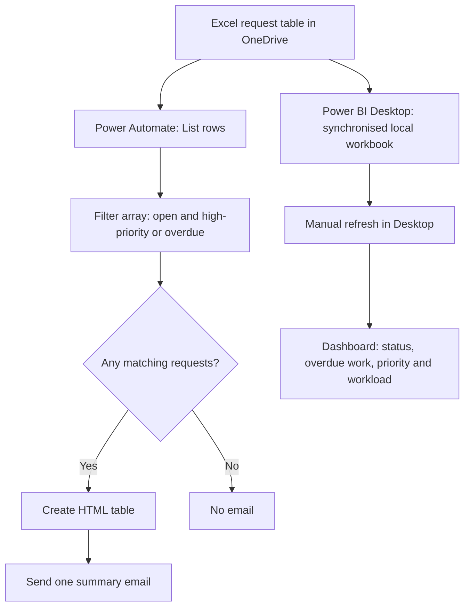

# Legal & Compliance Operations Hub

**Tools:** Power BI · DAX · Excel · OneDrive · Power Automate  
**Project type:** Portfolio prototype using fictional request data  
**Status:** Core reporting and email workflow tested; scheduled and no-match behaviour still require final operational verification.

## Overview

The Legal & Compliance Operations Hub is a small operational analytics and notification prototype for a fictional team handling legal and compliance requests. It combines a Power BI dashboard for monitoring the overall workload with a Power Automate flow that identifies requests needing attention and sends a summary email.

The workbook `Legal_Compliance_Requests.xlsx` is the shared source of request data. Power Automate reads the cloud workbook in OneDrive. Power BI Desktop reads the locally synchronised copy and is refreshed manually in Desktop. In this version, Power Automate does **not** directly refresh or control Power BI.

All example request records are intended to be fictional. Do not publish private workbook contents, credentials, connection details, personal email addresses, or unredacted run-history screenshots.

## Business problem

A Legal & Compliance team may be responsible for requests with different types, priorities, statuses, due dates, and assignees. Manually reviewing the full spreadsheet each day is repetitive and makes it easier to overlook urgent or overdue work.

This prototype supports that process by:

- showing workload and request status in Power BI;
- selecting requests that meet a clear, documented attention rule;
- sending one HTML summary email containing the matching requests.

## Business rule

A request is selected when it is **not closed** and either has **High** priority or has a due date before today's date in Prague:

```text
Status != "Closed" AND (Priority == "High" OR Due_Date < Today)
```

A request due today is not considered overdue by this rule. A closed request is excluded even if it is High priority or past its due date. See [`docs/business-rules.md`](docs/business-rules.md) for the detailed explanation.

## Architecture



The tools use the same underlying workbook but have separate responsibilities. Power BI reports on the data; Power Automate applies the notification rule. They do not directly trigger or refresh one another in this prototype. Read [`docs/architecture.md`](docs/architecture.md) for details.

## Power Automate workflow

The intended scheduled flow is:

1. **Recurrence** — configured for weekdays at 09:00 in `Central Europe Standard Time`.
2. **List rows present in a table** — reads `tbl_LegalRequests` from the OneDrive workbook.
3. **Filter array** — keeps open requests that are High priority or overdue.
4. **Condition** — checks whether the filtered array has more than zero records.
5. **True branch:** Create HTML table → Send an email (V2).
6. **False branch:** no action, so no summary email is sent when nothing matches.

The HTML table input must be `body('Filter_array')`. Custom column values use expressions such as `item()?['Request_ID']`; selecting individual row fields from Dynamic content had caused Power Automate to add an unnecessary `For each` loop. The corrected flow was test-run successfully and sent one email containing six matching request rows.

The scheduled flow is enabled. Its first unattended scheduled execution and the no-match scenario still need independent verification; see [`docs/testing-and-status.md`](docs/testing-and-status.md). The separate manual flow is retained for deliberate testing and should not be run during normal operation unless a separate test email is desired.

## Power BI reporting

The Power BI dashboard was built with request-monitoring visuals and DAX measures for operational reporting. The intended reporting areas include request volume and status, request types, overdue work by priority, and workload by assignee.

Power BI Desktop currently reads the locally synchronised version of the OneDrive workbook. Refresh it from **Home → Refresh** when updated data should be loaded. Automatic Power BI Service refresh is outside the scope of this prototype.

## Screenshots

Place reviewed screenshots in [`screenshots/`](screenshots/). Use the filenames and guidance listed in [`screenshots/README.md`](screenshots/README.md). The most useful portfolio evidence is:

- the Power BI dashboard overview;
- the full scheduled flow structure;
- the Filter array rule;
- the email containing the six filtered rows;
- a successful flow run.

Only use screenshots from your own project, and redact account details before committing them.

## Repository structure

```text
legal-compliance-operations-hub/
├── README.md
├── .gitignore
├── docs/
│   ├── README.md
│   ├── architecture.md
│   ├── business-rules.md
│   ├── data-dictionary.md
│   ├── setup-and-validation.md
│   └── testing-and-status.md
├── sample_data/
│   └── README.md
├── screenshots/
│   └── README.md
└── workflow/
    └── README.md
```

Check `git status --short` before every commit. `.gitignore` does not remove files that Git is already tracking.

## Project status and next validation

**Verified:** Excel row retrieval; Filter array logic in an inspected run; six matching rows in that run; HTML table configuration; successful test email containing the six filtered rows; corrected structure without a `For each` around the summary actions.

**Still to verify:** first unattended scheduled execution at the configured recurrence; no-match behaviour (False branch sends no email); and a final review of screenshots and sample data before the repository is made public. Do not describe these outstanding checks as passed until they have been observed.

See [`docs/testing-and-status.md`](docs/testing-and-status.md) for the detailed log and validation checklist.
