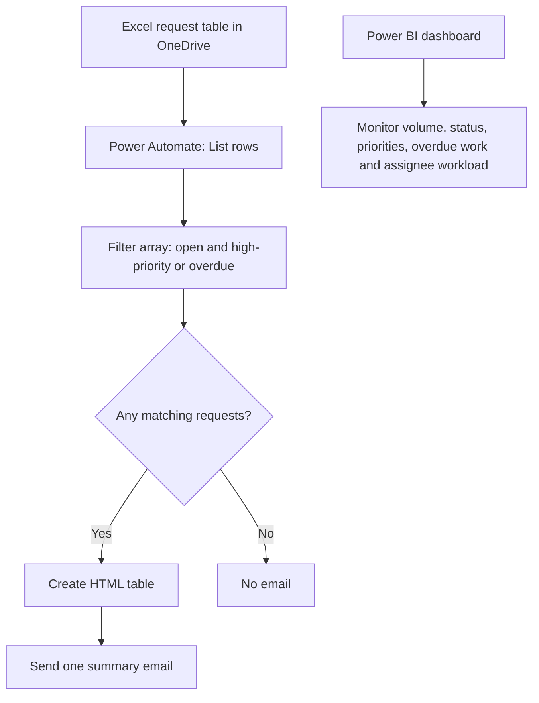

# Legal & Compliance Operations Hub

**Tools:** Power BI · DAX · Excel · OneDrive · Power Automate  
**Status:** In progress — the manual data/filtering workflow has been tested; scheduled email automation is still being validated.

## Overview

This portfolio project prototypes a lightweight operations hub for a fictional Legal & Compliance team. It uses synthetic request data to explore how a team can monitor request volumes and workload, identify requests requiring attention, and prepare an email summary.

The project combines two layers:

- **Power BI:** operational reporting and visual monitoring.
- **Power Automate:** retrieving request rows, applying business rules, preparing an HTML summary and sending email notifications.

All request data is fictional and intended for demonstration only.

## Business problem

Legal and Compliance teams may receive requests with different types, priorities, statuses and due dates. Manually reviewing a spreadsheet to identify urgent or overdue work can be repetitive. This prototype tests a simple, transparent rule-based approach for highlighting requests that require attention.

## Business rule

A request is selected when it is not closed and either:

- its priority is `High`; **or**
- its due date is before the current date in Prague.

In Boolean logic:

```text
Status != "Closed" AND (Priority == "High" OR Due_Date < Today)
```

The due-date comparison is strict: a request due today is not considered overdue.

## Solution architecture



The diagram shows the intended design. The scheduled version remains under validation and is currently kept turned off until its behaviour is verified.

## Implemented so far

- Built a Power BI dashboard using synthetic Legal & Compliance request data.
- Created DAX measures and visuals for request volume/status, request types, overdue requests by priority and workload by assignee.
- Stored the request workbook in personal OneDrive and connected Power Automate using the **Excel Online (OneDrive)** connector.
- Successfully retrieved rows from the Excel table `tbl_LegalRequests` (successful action response, HTTP status 200).
- Built and tested a Filter array rule. In one test run, six requests matched the rule.
- Configured an HTML table with request ID, request type, due date, priority, status and assignee columns.
- Successfully sent a test email containing request information.

## Current status and known limitation

The first scheduled-flow attempt sent more emails than intended. A `For each` container had wrapped reporting actions, so the flow was restructured to put the Condition before the HTML table and email. The intended structure is:

1. Recurrence
2. List rows present in a table
3. Filter array
4. Condition: `length(body('Filter_array')) > 0`
   - **True:** Create HTML table → Send one summary email
   - **False:** do nothing

The scheduled version has **not yet passed a final end-to-end validation** and should remain turned off until a controlled test confirms that it sends at most one email per run and includes only filtered requests. The earlier email output also needs verification against the six-row filter result.

## Repository contents

- `docs/architecture.md` — workflow design and component responsibilities.
- `docs/testing-and-status.md` — verified tests, current status and next validation steps.
- `sample_data/README.md` — notes for adding the synthetic workbook or a sanitised CSV export.
- `screenshots/` — place genuine screenshots of the Power BI report and Power Automate run history here.
- `workflow/README.md` — notes for exporting and documenting the Power Automate workflow.

## How to evaluate the project

1. Review the business rule and architecture above.
2. Review screenshots of the Power BI report and a successful Power Automate execution when added.
3. Check the testing log for verified and outstanding items.
4. Do not treat the scheduled automation as complete until the outstanding validation is documented.

## Privacy and security

Only use synthetic data in this public repository. Do not commit credentials, connection details, real legal/compliance requests, personal email addresses, exported run histories containing personal information, or files that expose private account data. Keep the actual Power Automate flow in your own Microsoft environment and share screenshots or a sanitised flow export only after checking for secrets and identifiers.

## Future improvements

- Complete controlled validation of the scheduled flow.
- Verify that the email contains only the filtered records and is sent no more than once per run.
- Test the no-matches case and confirm that no email is sent.
- Add genuine dashboard/workflow screenshots and a sanitised example dataset.
- Document execution frequency, error handling and any remaining limitations.
