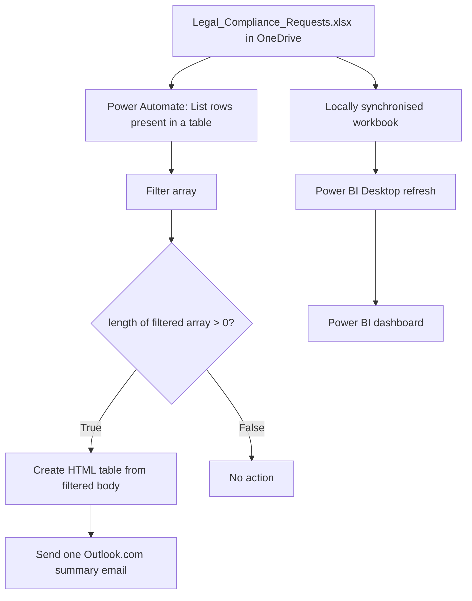

# Architecture and workflow design

## Purpose

This prototype pairs operational reporting with a lightweight notification workflow for a fictional Legal & Compliance team.

- **Excel in OneDrive:** shared source of request records.
- **Power BI Desktop:** reporting view over the locally synchronised copy of the same workbook. Data refresh is manual in Desktop.
- **Power Automate:** reads the cloud workbook, filters requests, creates an HTML table, and sends one summary email when qualifying requests exist.
- **Outlook.com connector:** delivers the summary email to the configured recipient.

Power BI and Power Automate use the same underlying workbook but do not directly trigger or refresh each other in this prototype.

## Data path



## Source data

- Workbook: `Legal_Compliance_Requests.xlsx`
- Excel table: `tbl_LegalRequests`
- Power Automate connector: Excel Online (OneDrive), using the cloud workbook.
- Power BI source: locally synchronised copy of the same workbook.

The column names and values are expected to stay consistent with the definitions in [`data-dictionary.md`](data-dictionary.md).

## Power Automate action design

1. **Recurrence** — weekday schedule at 09:00; time zone `Central Europe Standard Time`.
2. **List rows present in a table** — retrieves the row array.
3. **Filter array** — its `From` input is the `value` array returned by the Excel action.
4. **Condition** — checks if at least one row passed the filter.
5. **True branch:** Create HTML table → Send an email (V2).
6. **False branch:** no actions.

The condition is configured using the basic fields:

- Left value (Expression): `length(body('Filter_array'))`
- Operator: `is greater than`
- Right value: `0`

The HTML table **From** input must be:

```text
body('Filter_array')
```

It must not point to the original Excel `value` array, or every source row may appear in the email instead of only the filtered rows.

## Filter expression

The Filter array input is:

```text
outputs('List_rows_present_in_a_table')?['body/value']
```

The filter rule is equivalent to:

```text
Status != "Closed" AND (Priority == "High" OR Due_Date < Today in Prague)
```

The configured expression is documented in [`workflow/README.md`](../workflow/README.md). It assumes the source field names and values remain unchanged.

## HTML table columns

The summary table includes:

| Email header | Source field / expression |
|---|---|
| Request ID | `item()?['Request_ID']` |
| Request Type | `item()?['Request_Type']` |
| Due Date | `formatDateTime(item()?['Due_Date'], 'dd MMM yyyy')` |
| Priority | `item()?['Priority']` |
| Status | `item()?['Status']` |
| Assigned To | `item()?['Assigned_To']` |

Custom values are entered through the Expression editor. Selecting per-row dynamic content had prompted Power Automate to generate a `For each` loop. For this design, the HTML table and summary email process the filtered array as a whole and should not be wrapped in that loop.

## Reporting layer

Power BI provides the manager-facing overview. Refresh is manual in Power BI Desktop. Automatic refresh through Power BI Service is not implemented. The dashboard and notification flow are two consumers of the same source workbook with different purposes.
